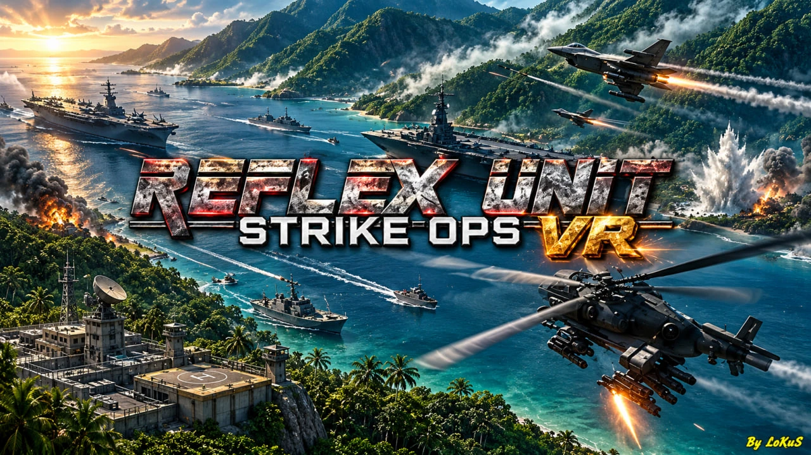
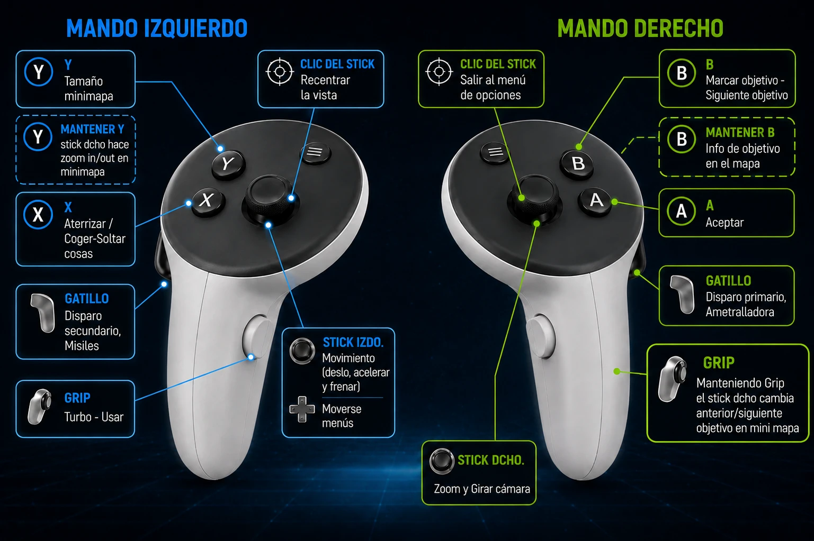

# StrikeOpsXR

[English](README.md) | **Español**



Mod VR (OpenXR) para **Reflex Unit Strike Ops** (Unity 2022.3.22f1, Mono, URP, solo Vulkan).
Probado en las versiones del juego v1.0.3 y v1.1.4 (build 21335037).

Estado: renderizado estéreo con tracking del casco, HUD y menús en un panel flotante, mandos VR mapeados, apuntado con el mando derecho y cámara que sigue al helicóptero (zoom y giro con el stick derecho).

## Instalación

1. Descarga `StrikeOpsXR_<versión>_release.zip` de [Releases](https://github.com/lokus77/StrikeOpsXR/releases).
2. Descomprímelo en la carpeta del juego (junto a `StrikeOps.exe`). Ya incluye BepInEx.
3. Conecta el casco (Virtual Desktop, Steam Link o Meta Link) y lanza `StrikeOps.exe`.

**Primer arranque:** el mod activa la preinicialización de OpenXR en `StrikeOps_Data/boot.config`. Unity lee ese fichero antes de que se cargue el mod, así que la primera vez el juego se cierra y se vuelve a abrir solo.

**Jugar en plano:** `Jugar sin VR.bat`.

**Runtime OpenXR:** si no quieres que el juego abra Steam, lanza una vez `OpenXR_Forzar_VirtualDesktop.bat`. Así el juego usará siempre el OpenXR de Virtual Desktop (VDXR), aunque otro runtime (SteamVR, Meta, Pico...) sea el activo del sistema. No cambia nada en Windows, solo `General.OpenXRRuntimeJson` en `BepInEx\config\strikeopsxr.cfg` (que se crea al arrancar el juego una vez con el mod). `OpenXR_RestaurarDefault.bat` vuelve al runtime por defecto del sistema.

## Mandos



## Novedades 0.2.2

- Botón Y: cambia el tamaño del minimapa.
- Mantener Y + stick derecho arriba/abajo: cambia el nivel de zoom del minimapa.
- Mantener grip derecho + stick derecho izquierda/derecha: objetivo anterior/siguiente en el minimapa.
- Añadidos `OpenXR_Forzar_VirtualDesktop.bat` y `OpenXR_RestaurarDefault.bat` (ver *Runtime OpenXR*).

## Novedades 0.2.1

- Corregidos los tirones y la imagen doble del helicóptero en VR.

## Novedades 0.2.0

- Compatible OpenXR (por defecto). VDXR (Virtual Desktop) funciona bien y no necesita Steam.
- Música habilitada por defecto.
- Correcciones visuales: sin la mira 2D, la línea de puntos ni el recuadro del objetivo fijado (en VR no coincidían con el mundo), sin el fondo gris desenfocado de los menús y sin temblor de cámara al recibir impactos.
- Vibración de los mandos al lanzar misiles y al recibir daño (si está activada en las opciones del juego).
- Mejor rendimiento (FPS): sin límite de FPS del juego, sombras y SSAO ajustados y recorte de objetos lejanos.
- Mayor distancia de dibujado de la vegetación; el mar llega hasta el horizonte.
- La ventana del juego coge el foco al arrancar. La vista empieza siempre en distancia 0.75 y giro 0°.

## Configuración

Está en `BepInEx/config/strikeopsxr.cfg`, que se genera en el primer arranque. Cada opción lleva su descripción en el propio fichero.

## Requisitos de compilación

- .NET SDK 8 o superior (no hace falta Unity).
- BepInEx **5.4.x win x64** instalado en el juego. Hay que arrancar el juego una vez para que cree sus carpetas.
- `boot.config` del juego con `gfx-enable-native-gfx-jobs=0`.
- Un runtime OpenXR compatible con **Vulkan**: Virtual Desktop (VDXR, sin Steam), SteamVR o Meta Quest Link. WMR no sirve.

## Compilar e instalar

```powershell
.\deploy.ps1
```

## Probar

1. Conéctate con Virtual Desktop / Steam Link / Meta Link, con el runtime OpenXR en marcha **antes** de lanzar el juego.
2. Lanza `StrikeOps.exe`.
3. Revisa los logs:
   - `BepInEx/LogOutput.log`: tiene que aparecer `OpenXR en marcha. Runtime: ...` y `Cámara del juego: ...`.
   - `%USERPROFILE%\AppData\LocalLow\Robosaru\StrikeOps\Player.log`: busca la línea
     `[Vulkan init] SelectPhysicalDevice ... xrDevice=`. **Si el valor no es nulo**, OpenXR ha intervenido en la creación de Vulkan.
4. Para recentrar: **F8** o clic del stick izquierdo. También se recentra solo al ponerse el casco.

Para arrancar en plano sin desinstalar: `StrikeOps.exe --disable-vr`. Así ni siquiera se carga `UnityOpenXR.dll`.

## Licencia

GPL-3.0, porque partes del código derivan de RepoXR (© DaXcess). Los binarios de `lib/` pertenecen a Unity Technologies (plugin OpenXR) y a The Khronos Group (loader OpenXR).
