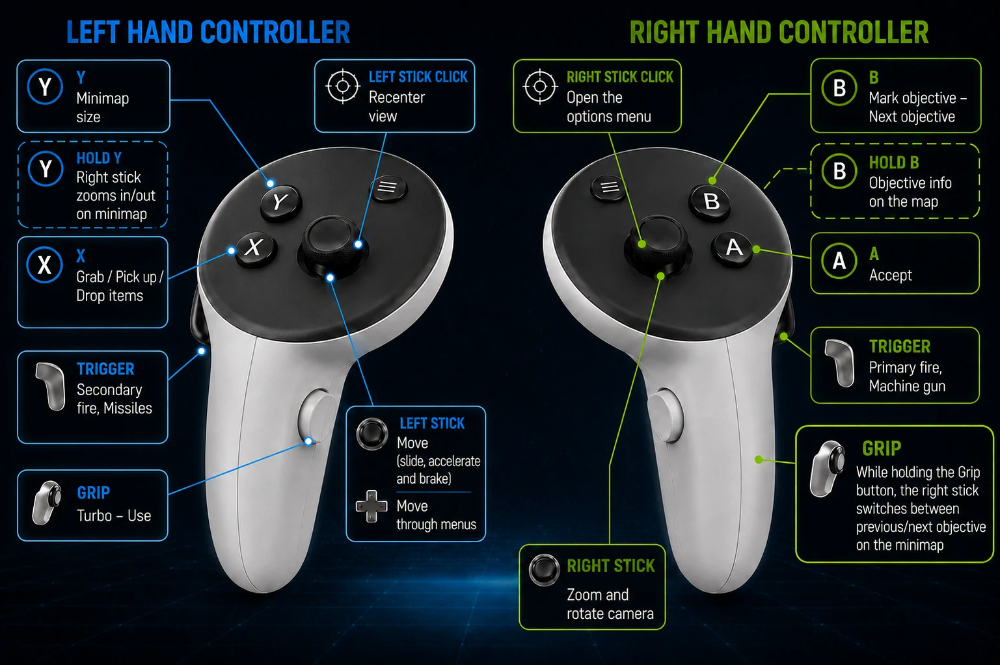

# StrikeOpsXR

**English** | [Español](README.es.md)


VR (OpenXR) mod for **Reflex Unit Strike Ops** (Unity 2022.3.22f1, Mono, URP, Vulkan only).
Tested with game versions v1.0.3 and v1.1.4 (build 21335037).

Status: stereo rendering with head tracking, HUD and menus on a floating panel, mapped VR controllers, aiming with the right controller, and a camera that follows the helicopter (zoom and rotate with the right stick).

## Installation

1. Download `StrikeOpsXR_<version>_release.zip` from [Releases](https://github.com/lokus77/StrikeOpsXR/releases).
2. Extract it into the game folder (next to `StrikeOps.exe`). BepInEx is included.
3. Connect your headset (Virtual Desktop, Steam Link or Meta Link) and launch `StrikeOps.exe`.

**First launch:** the mod enables OpenXR pre-initialization in `StrikeOps_Data/boot.config`. Unity reads that file before the mod loads, so on the first launch the game closes and reopens by itself.

**Play flat (no VR):** `Jugar sin VR.bat`.

** My recommended game settings (optional):** double-click `Config_recomendada_del_juego.reg` and accept. It writes to the registry (`HKCU\Software\Robosaru\StrikeOps`): 1600x1050 windowed, 120 FPS, no VSync or antialiasing, vibration on, Spanish language and no pause on messages (change the language in the game options afterwards if you want). See `Leeme.txt` (Spanish).

**OpenXR runtime:** if you don't want the game to open Steam, run `OpenXR_Forzar_VirtualDesktop.bat` once. The game will then always use the Virtual Desktop OpenXR runtime (VDXR), even if another runtime (SteamVR, Meta, Pico...) is the system's active one. It changes nothing in Windows, only `General.OpenXRRuntimeJson` in `BepInEx\config\strikeopsxr.cfg` (created the first time the game runs with the mod). `OpenXR_RestaurarDefault.bat` goes back to the system's default runtime.

## Controls



## What's new in 0.2.2

- Y button: changes the minimap size.
- Hold Y + right stick up/down: changes the minimap zoom level.
- Hold right grip + right stick left/right: previous/next target on the minimap.
- Added `OpenXR_Forzar_VirtualDesktop.bat` and `OpenXR_RestaurarDefault.bat` (see *OpenXR runtime*).

## What's new in 0.2.1

- Fixed helicopter stutter and double image in VR.

## What's new in 0.2.0

- OpenXR support (default). VDXR (Virtual Desktop) works well and doesn't need Steam.
- Music enabled by default.
- Visual fixes: no 2D crosshair, dotted line or locked-target box (they didn't line up with the world in VR), no blurred grey menu background, and no camera shake when hit.
- Controller vibration when firing missiles and taking damage (if enabled in the game options).
- Better performance (FPS): no game FPS cap, tuned shadows and SSAO, and culling of distant objects.
- Longer vegetation draw distance; the sea reaches the horizon.
- The game window takes focus on launch. The view always starts at distance 0.75 and 0° rotation.

## Configuration

It's in `BepInEx/config/strikeopsxr.cfg`, generated on first launch. Each option has its description in the file itself.

## Build requirements

- .NET SDK 8 or later (Unity is not needed).
- BepInEx **5.4.x win x64** installed in the game. Launch the game once so it creates its folders.
- The game's `boot.config` with `gfx-enable-native-gfx-jobs=0`.
- An OpenXR runtime that supports **Vulkan**: Virtual Desktop (VDXR, no Steam), SteamVR or Meta Quest Link. WMR does not work.

## Build and install

```powershell
.\deploy.ps1
```

## Testing

1. Connect with Virtual Desktop / Steam Link / Meta Link, with the OpenXR runtime running **before** launching the game.
2. Launch `StrikeOps.exe`.
3. Check the logs:
   - `BepInEx/LogOutput.log`: it should show `OpenXR en marcha. Runtime: ...` and `Cámara del juego: ...` (the mod logs in Spanish).
   - `%USERPROFILE%\AppData\LocalLow\Robosaru\StrikeOps\Player.log`: look for the line
     `[Vulkan init] SelectPhysicalDevice ... xrDevice=`. **If the value is not null**, OpenXR took part in creating the Vulkan device.
4. To recenter: **F8** or left stick click. It also recenters by itself when you put the headset on.

To launch flat without uninstalling: `StrikeOps.exe --disable-vr`. This doesn't even load `UnityOpenXR.dll`.

## License

GPL-3.0, because parts of the code derive from RepoXR (© DaXcess). The binaries in `lib/` belong to Unity Technologies (OpenXR plugin) and The Khronos Group (OpenXR loader).
