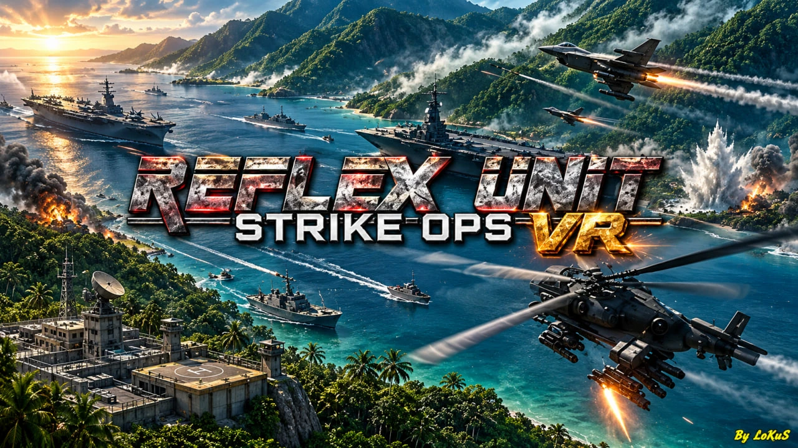

# StrikeOpsXR



Mod VR (OpenXR) para **Reflex Unit Strike Ops** (Unity 2022.3.22f1, Mono, URP, solo Vulkan).

Estado: renderizado estéreo con tracking del casco, HUD y menús en un panel flotante, mandos VR mapeados, apuntado con el mando derecho y cámara que sigue al helicóptero (zoom y giro con el stick derecho).

## Novedades 0.2.0

- Compatible OpenXR (por defecto). VDXR (Virtual Desktop) funciona bien y no necesita Steam.
- Música habilitada por defecto.
- Correcciones visuales: sin la mira 2D, la línea de puntos ni el recuadro del objetivo fijado (en VR no coincidían con el mundo), sin el fondo gris desenfocado de los menús y sin temblor de cámara al recibir impactos.
- Vibración de los mandos al lanzar misiles y al recibir daño (si está activada en las opciones del juego).
- Mejor rendimiento (FPS): sin límite de FPS del juego, sombras y SSAO ajustados y recorte de objetos lejanos.
- Mayor distancia de dibujado de la vegetación; el mar llega hasta el horizonte.
- La ventana del juego coge el foco al arrancar. La vista empieza siempre en distancia 0.75 y giro 0°.

**Primer arranque:** el mod activa la preinicialización de OpenXR en `StrikeOps_Data/boot.config`. Unity lee ese fichero antes de que se cargue el mod, así que la primera vez hay que cerrar el juego y volver a abrirlo. Para jugar en plano: `Jugar sin VR.bat`.

## Mandos


## Cómo funciona

| Pieza | Qué hace |
|---|---|
| `Preload/` (patcher de BepInEx) | Antes de que arranque el motor copia `UnityOpenXR.dll` y `openxr_loader.dll` a `StrikeOps_Data/Plugins/x86_64` y escribe `StrikeOps_Data/UnitySubsystems/UnityOpenXR/UnitySubsystemsManifest.json`. Así Unity carga OpenXR **antes de crear el dispositivo Vulkan**. |
| `Plugin/OpenXRBoot.cs` | Crea en runtime `XRGeneralSettings`, `XRManagerSettings` y `OpenXRLoader`, fija multi-pass, registra los perfiles de mando y arranca los subsistemas. |
| `Plugin/VRRig.cs` | La cámara del juego (Cinemachine, `Camera.main`) sigue viva, pero sin renderizar nada, para que el movimiento, el apuntado y el HUD funcionen sin parches. Una cámara XR nueva sigue su posición y su yaw, y aplica encima el pose del casco. |
| `Plugin/PostFx.cs` | Desactiva tilt-shift, DOF, motion blur y efectos de lente. |
| `lib/` | Binarios XR de Unity tomados de la rama `thunderstore` de [RepoXR](https://github.com/DaXcess/RepoXR): plugin OpenXR 1.10.0 con soporte Vulkan y loader de Khronos 1.1.54. |

## Requisitos

- .NET SDK 8 o superior (no hace falta Unity).
- BepInEx **5.4.x win x64** instalado en el juego. Hay que arrancar el juego una vez para que cree sus carpetas.
- `boot.config` del juego con `gfx-enable-native-gfx-jobs=0`.
- Un runtime OpenXR compatible con **Vulkan**: Virtual Desktop (VDXR, sin Steam), SteamVR o Meta Quest Link. WMR no sirve.

## Compilar e instalar

```powershell
.\deploy.ps1
```

Con otra ruta del juego: `.\deploy.ps1 -GamePath "D:\...\Reflex.Unit.Strike.Ops"`. Para desinstalar: `.\deploy.ps1 -Uninstall`.

## Probar

1. Enciende el casco y el runtime OpenXR **antes** de lanzar el juego.
2. Lanza `StrikeOps.exe`.
3. Revisa los logs:
   - `BepInEx/LogOutput.log`: tiene que aparecer `OpenXR en marcha. Runtime: ...` y `Cámara del juego: ...`.
   - `%USERPROFILE%\AppData\LocalLow\Robosaru\StrikeOps\Player.log`: busca la línea
     `[Vulkan init] SelectPhysicalDevice ... xrDevice=`. **Si el valor no es nulo**, OpenXR ha intervenido en la creación de Vulkan.
4. Para recentrar: **F8** o clic del stick izquierdo. También se recentra solo al ponerse el casco.

Para arrancar en plano sin desinstalar: `StrikeOps.exe --disable-vr`. Así ni siquiera se carga `UnityOpenXR.dll`.

## Configuración

Está en `BepInEx/config/strikeopsxr.cfg`, que se genera al primer arranque:

| Clave | Por defecto | Notas |
|---|---|---|
| `General.DisableVR` | false | |
| `General.OpenXRRuntimeJson` | "" | Fuerza un runtime concreto (ruta a su `.json`) |
| `Rendering.RenderScale` | 1.0 | Resolución de los ojos |
| `Rig.WorldScale` | 1.0 | >1 = efecto maqueta (pruébalo con 10–30) |
| `Rig.FollowCameraPitch` | false | true = hereda la inclinación de la cámara del juego |
| `Rig.HeightOffset` / `Rig.BackOffset` | 0 | Ajuste fino de la posición del rig |
| `Rig.RecenterKey` | F8 | |
| `Rig.ScaleSpeed` | 1.0 | Velocidad del ajuste de escala en vivo |

**Escala en vivo:** mantén el **grip izquierdo** y mueve el **stick izquierdo** arriba o abajo. Grip + clic del stick vuelve a 1. Al soltar el grip se guarda en `Rig.WorldScale`.
| `PostFx.*` | true | Desactivan DOF/tilt-shift, motion blur y efectos de lente |

## Pendiente (siguientes hitos)

- **HUD en el casco** (`Plugin/UiOverlay.cs`, primera versión): cada `PanelSettings` renderiza a un RenderTexture que se muestra en un panel flotante (`UI.*` en el `.cfg`), con un cursor propio. Pendiente: alinear con el mundo los marcadores del HUD (usan `WorldToScreenPoint` de la cámara del juego).
- **Mandos VR** (`Plugin/VRControls.cs`, primera versión):
  - Y = E (mapa), A = Enter.
  - Stick izquierdo = flechas en menús y movimiento analógico en juego (parche sobre `LocalPlayerInput.Update`).
  - X = Q (aterrizar), B = Z (siguiente objetivo), grip derecho = T (cambiar objetivo en el mapa).
  - Gatillo derecho = `PrimaryFire`, gatillo izquierdo = `SecondaryFire`, resueltos en tiempo de ejecución a su tecla o botón de ratón.
  - Indicaciones en pantalla con el botón VR (`Plugin/VRPrompts.cs`): sustituye el `keyboardSprite` de cada acción en `DeviceSprites` por el icono de mando equivalente.
  - Apuntado con el mando derecho (`Plugin/VRAim.cs`): un rayo desde el mando contra `PoolManager.mouseAimingLayer`; el punto se proyecta a la pantalla de la cámara del juego y se mueve el ratón ahí. Muestra un láser.
- **Confort**: suavizar el seguimiento del rig.
- **Verificar**: que el parche de IPD (`Plugin/IpdScale.cs`, prefijo de Harmony en `XRView`) da un efecto maqueta correcto, y que las nubes volumétricas y `sc.posteffects` se ven bien en estéreo.

## Licencia

GPL-3.0, porque partes del código derivan de RepoXR (© DaXcess). Los binarios de `lib/` pertenecen a Unity Technologies (plugin OpenXR) y a The Khronos Group (loader OpenXR).
